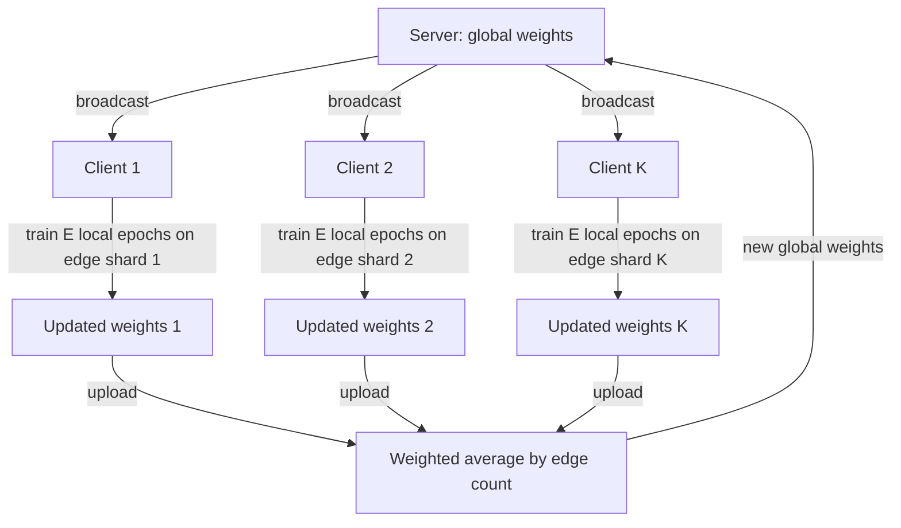

# Federated GNN Link Prediction on ogbl-ddi

<p align="center">
  <a href="LICENSE"></a>
  
  
  
  
</p>

> Federated graph learning with **FedAvg + GraphSAGE** for drug–drug interaction (DDI) prediction on OGB `ogbl-ddi`.

Several simulated institutions each hold a disjoint shard of known drug–drug
interactions and collaboratively train one shared GNN with **FedAvg**, exchanging
only model weights — never raw interaction records. A centralized upper bound and
a no-collaboration local-only baseline make the cost of federation measurable.
The primary metric is **Hits@20**, scored with the official OGB evaluator.

## Highlights

- **Three regimes, one CLI** — `centralized`, `federated` (FedAvg), and
  `local`-only, selected with a single `--mode` flag.
- **Privacy-preserving by design** — clients exchange only weights and run
  message passing / negative sampling solely on their own edges.
- **Official evaluation** — Hits@10/20/30 via the OGB `ogbl-ddi` evaluator, with
  model selection on validation only.
- **Reproducible** — a fixed seed controls both sharding and training; one CSV
  per run.
- **Resumable** — CSVs are flushed every round and completed runs are skipped on
  re-run.
- **Lightweight** — single-GPU friendly and uses only `edge_index` (no
  `torch_sparse` extension).

## Table of Contents

- [Background](#background)
- [Method](#method)
- [Evaluation protocol](#evaluation-protocol)
- [Installation](#installation)
- [Quick start](#quick-start)
- [Outputs](#outputs)
- [FAQ](#faq)
- [Limitations](#limitations)
- [Project structure](#project-structure)
- [References](#references)
- [Citation](#citation)

## Background

**Dataset.**
[`ogbl-ddi`](https://ogb.stanford.edu/docs/linkprop/#ogbl-ddi) is a homogeneous,
undirected graph of **4,267 drug nodes** and **~1.33M edges** (known
interactions), with **no node or edge features** — the model learns node
representations from structure alone. Its official **protein-target split**
places validation/test interactions on drugs acting on different proteins than
the training edges, so the model must generalize beyond the interactions it saw.

**Metric.** For every true interaction, its score is compared against a fixed,
shared set of **~100,000 negative drug pairs**; it is a "hit" if it ranks above
the K-th highest negative. **Hits@K** is the fraction of positives that are hits.
This repo reports Hits@10, **Hits@20** (primary), and Hits@30.

## Method

**Model** (following the official OGB `ddi` GNN baseline; all three parts live in
one module, so a single `state_dict` is what FedAvg averages):

- **Node embeddings** — a learnable `nn.Embedding`, 256-d per node (Xavier init).
- **Encoder** — 2-layer GraphSAGE (default) or GCN, hidden 256, ReLU, dropout 0.5.
- **Decoder** — the Hadamard product `h_u * h_v` through a 2-layer MLP
  (hidden 256, dropout 0.5) and a sigmoid.

Training uses binary cross-entropy on each batch's positive edges plus an equal
number of freshly sampled negatives, with Adam and gradient clipping at 1.0. Each
mini-batch recomputes the encoder over the full message-passing graph, then
scores only that batch's edges.

**Federated setup.** Training edges are shuffled with a fixed seed and split into
**K disjoint, equal shards**, one per client. Every client shares the full node
set but only ever sees its own edges. Each round, clients train locally and the
server averages their weights with **FedAvg weighted by edge count**.

**Supported modes (`--mode`):**

- **`centralized`** — one model on the union of all training edges. Upper bound.
- **`federated`** — K clients train on their shards, aggregated via FedAvg each
  round. Main setting.
- **`local`** — K clients train independently with no aggregation; the reported
  metric is the mean over clients. No-collaboration baseline.

All modes share one compute budget: a federated/local run does
`rounds × local_epochs` local epochs, and `centralized` trains for the same
number of epochs while evaluating every `local_epochs` epochs — giving `rounds`
evaluation points so the "communication round" axis is comparable across modes.

**One FedAvg round:**



## Evaluation protocol

Following the OGB rules:

- **Validation-only model selection.** `summarize.py` reports the test Hits@20 at
  the round whose **validation** Hits@20 is highest; test never picks a round.
- **Validation/test edges** are never used for training or message passing — only
  scored as positives against the fixed negative set.
- **Message-passing graph at evaluation.** `centralized` and `federated` encode
  using the **full official train graph** (for `federated`, the union of all
  shards — the global model is evaluated as if it had the combined graph);
  `local` evaluates each client on **only its own shard** and averages.
- **Convergence round** is the first round at which validation Hits@20 reaches
  **≥ 95%** of its best value over the run.

## Installation

Developed and tested with the versions in `requirements.txt`: Python 3.12,
PyTorch 2.11.0, PyTorch Geometric 2.8.1, OGB 1.3.6, NumPy 2.1.3, matplotlib
3.10.0.

```bash
pip install -r requirements.txt
```

## Quick start

The `ogbl-ddi` dataset (~100 MB) downloads automatically on first run into
`--data_root` (default `dataset/`).

**Run all four experiments**, then produce the plot and summary:

```bash
OUT=results/ bash run_all.sh
```

Re-running skips any run whose CSV is already complete (≥ `--rounds` rows) and
restarts an interrupted run from round 0. CSV names encode only `mode`,
`encoder`, `num_clients`, and `seed`, so move or delete the old CSV when varying
other hyperparameters.

**Run a single experiment:**

```bash
python main.py --mode centralized --encoder sage                     # upper bound
python main.py --mode federated   --encoder sage --num_clients 4     # main result
python main.py --mode federated   --encoder gcn  --num_clients 4     # GCN baseline
python main.py --mode local       --encoder sage --num_clients 4     # no collaboration
```

**Tiny CPU smoke-test** (verifies the setup end to end; not a real experiment):

```bash
python main.py --mode federated --encoder sage --num_clients 2 \
    --rounds 1 --local_epochs 1 --batch_size 4096 --max_batches 2 --device cpu
```

**Generate the plot and summary** from existing CSVs:

```bash
python plot.py      --out results/ --num_clients 4 --seed 0
python summarize.py --out results/ --num_clients 4 --seed 0
```

## Outputs

All files are written under `--out` (default `results/`):

- **Per-run CSV** — `centralized_<encoder>_seed<seed>.csv`, or
  `<mode>_<encoder>_K<num_clients>_seed<seed>.csv` for `federated`/`local`. One
  row per round: `round, loss, valid/test hits@10/20/30` (also printed to stdout).
- **`hits20.png`** — validation and test Hits@20 vs. round for all four runs.
- **`summary.md`** — per-method test Hits@20 at the best-validation round, the
  convergence round, and a "CV numbers" section.

## FAQ

**Does federated training share raw interaction data?**
No. Clients exchange only model weights each round; each keeps its own edges and
runs message passing and negative sampling only on its own shard.

**Why learnable node embeddings instead of input features?**
`ogbl-ddi` has no node or edge features, so each node gets a trainable 256-d
vector learned jointly with the GNN — as in the official OGB `ddi` baseline.

**Why is FedAvg weighted by edge count?**
Shards are equal by default, but weighting by each client's edge count keeps
aggregation correct when they are uneven (e.g. when `num_clients` does not evenly
divide the number of training edges).

**Why evaluate the global model on the full train graph?**
Message passing needs a graph, and the global model stands for the federation as
a whole, so it is given the union of all clients' edges at evaluation. Local-only
models are instead evaluated on their own shard.

**Can I run it without a GPU?**
For a quick check, yes — the CPU smoke-test runs end to end in seconds. Full
training targets a single GPU.

## Limitations

- **Simulated federation.** Clients run sequentially on one machine; there is no
  real network and no privacy mechanism beyond weight-only exchange (no
  differential privacy or secure aggregation).
- **IID shards.** Edges are split uniformly at random, so clients are
  statistically similar; realistic non-IID / institution-skewed partitions are
  not modeled.
- **Single dataset, no features.** Findings on structure-only `ogbl-ddi` need not
  transfer to featured graphs or other domains.
- **FedAvg only.** Other aggregators (FedProx, FedAdam, …) and partial client
  participation are not implemented — all clients train every round.
- **Per-run resume only.** Interrupted runs restart from round 0; there is no
  per-round checkpointing.
- **Full-graph forward per batch.** The encoder is recomputed over the whole
  message-passing graph each mini-batch, so memory grows with graph size.

## Project structure

```
federated-drug-drug-interaction/
├── main.py           # CLI entry point; orchestrates centralized/federated/local runs, CSV logging, resume-skip
├── data.py           # ogbl-ddi loading, undirected graph building, seeded edge sharding, torch.load patch
├── model.py          # LinkPredModel: node embeddings + GraphSAGE/GCN encoder + Hadamard-MLP decoder
├── engine.py         # local training loop, OGB evaluation, weighted FedAvg aggregation
├── plot.py           # valid/test Hits@20 vs round, all methods -> results/hits20.png
├── summarize.py      # best-valid test Hits@20, convergence round, CV numbers -> results/summary.md
├── run_all.sh        # runs the 4 standard experiments sequentially, then plot + summarize
├── requirements.txt  # pinned dependency versions
├── LICENSE           # MIT
└── README.md
```

## References

- **OGB** — W. Hu, M. Fey, M. Zitnik, Y. Dong, H. Ren, B. Liu, M. Catasta,
  J. Leskovec. *Open Graph Benchmark: Datasets for Machine Learning on Graphs.*
  NeurIPS 2020. https://ogb.stanford.edu/
- **GraphSAGE** — W. L. Hamilton, R. Ying, J. Leskovec. *Inductive
  Representation Learning on Large Graphs.* NeurIPS 2017.
- **FedAvg** — B. McMahan, E. Moore, D. Ramage, S. Hampson, B. Agüera y Arcas.
  *Communication-Efficient Learning of Deep Networks from Decentralized Data.*
  AISTATS 2017.
- **Official OGB `ddi` example** —
  https://github.com/snap-stanford/ogb/tree/master/examples/linkproppred/ddi

## Citation

```bibtex
@software{liu2026_federated_ddi,
  author  = {Shiqing Liu},
  title   = {Federated GNN Link Prediction on ogbl-ddi},
  year    = {2026},
  url     = {https://github.com/Shiqing-Liu/federated-drug-drug-interaction}
}
```

## License

Released under the [MIT License](LICENSE).
